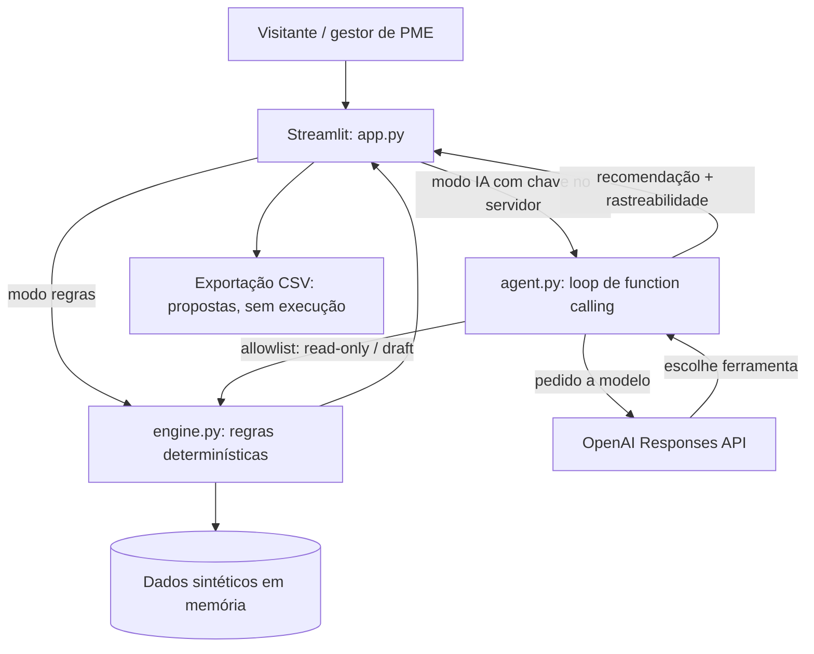
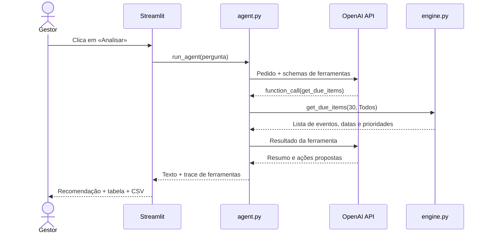

# OpsPilot AI — Arquitetura técnica (MVP demonstrável para PME)

## 1. Objetivo

Demonstrar em poucos minutos como um **agente único com ferramentas** pode consultar dados operacionais, pedir cálculos verificáveis, explicar prioridades e preparar um plano de ação. A primeira versão utiliza apenas dados sintéticos e não faz operações externas. Público-alvo: PME de logística, distribuição ou serviços com viaturas/equipamentos.

### Storyline demonstrativa

> «Analisa os prazos dos próximos 30 dias e apresenta prioridades e propostas de ação.»

Critério de sucesso: o visitante abre a aplicação, clica em «Analisar», vê prazos, fontes, prioridades e plano exportável em CSV; se a API estiver ativada, vê também as ferramentas chamadas pelo modelo.

## 2. Contexto e componentes



### Responsabilidades

| Componente | Responsável por | Não deve fazer |
|---|---|---|
| `app.py` | UI, estado de sessão, cenário, apresentação, exportação | Inventar regras ou guardar segredos no código |
| `agent.py` | Instruções, definição das ferramentas, dispatch autorizado, loop e trace | Calcular prazos na resposta ou executar ações não autorizadas |
| `engine.py` | Dados sintéticos, cálculo exato de prazos/prioridades, plano preliminar | Chamar a API de IA |
| `tests/` | Garantir cálculos e restrições de ferramentas | Depender da API real ou de credenciais |
| Streamlit Secrets | Disponibilizar chave apenas no servidor | Expor a chave ao navegador / GitHub |

## 3. Fluxo completo (quando IA está ativada)



No **modo de simulação**, não existe chamada à OpenAI: a UI lê diretamente o `engine.py` e apresenta um resumo baseado em regras. Este modo não deve ser descrito como execução de IA.

## 4. Contratos e dados

Exemplo de ativo (simplificado):

```json
{
  "id": "E-201",
  "tipo": "Empilhador",
  "local": "Armazém Norte",
  "deadlines": {
    "maintenance": "AAAA-MM-DD",
    "inspection": "AAAA-MM-DD"
  },
  "estimativa_eur": 420,
  "historico": "Avaria recorrente no carregador"
}
```

Ferramentas autorizadas:

1. `get_due_items(window_days, asset_type)` -> lista com ativo, evento, data, dias e prioridade.
2. `get_asset_history(asset_id)` -> histórico sintético de um ativo.
3. `draft_action_plan(window_days, asset_type)` -> ações propostas, sempre pendentes de validação humana.

As datas do dataset são criadas em relação ao dia da execução para que o exemplo continue a funcionar em diferentes datas. As regras de prioridade são demonstrativas: **Crítica** se vencida/hoje; **Alta** até 7 dias; **Média** no restante período analisado. Não correspondem, por si, a um parecer de conformidade legal ou prioridade técnica.

## 5. Decisões de arquitetura (ADRs resumidos)

**ADR-001 — Streamlit em vez de frontend + API separados.** Menor tempo de implementação, instalação simples e publicação direta. Trocar apenas quando houver vários canais, equipas ou integrações.

**ADR-002 — Um agente, não uma equipa multiagente.** O objetivo é mostrar uso de ferramentas e limites de autonomia, não criar complexidade artificial.

**ADR-003 — Regras determinísticas fora do LLM.** Dates, filtros e classificação são calculados e testados em Python. A IA interpreta os resultados.

**ADR-004 — Sem base de dados no MVP.** Dados sintéticos em memória. Adicionar CSV/SQLite apenas quando houver necessidade real; PostgreSQL só com persistência e múltiplos utilizadores.

**ADR-005 — Read-only/draft.** Nenhuma ordem de trabalho, email, compra ou alteração externa pode ser executada. A exportação CSV é manual.

**ADR-006 — API chave no servidor.** Nunca incorporar credenciais no repositório ou UI. Para link público, configurar orçamento e proteção contra abuso.

## 6. Segurança e operação

- Todos os dados são fictícios. Não convidar visitantes a inserir dados reais ou pessoais nesta demo pública.
- Apenas ferramentas explicitamente permitidas podem ser invocadas. O LLM não executa código arbitrário nem acessa rede externa por ferramentas.
- Tratar textos retornados por ferramentas como dados, não como instruções.
- O limite de 3 chamadas por sessão não é um rate limit global: **não evita abuso nem garante controlo de custos**. Para uma demonstração pública, é preferível expor só o modo de regras ou colocar autenticação e controlo de utilização do lado do servidor/proxy antes de ativar a API.
- Não registar chaves, informação pessoal ou respostas sensíveis em logs. Monitorizar consumo no projeto API.
- Em aplicações reais: identidade, autorização, isolamento de dados entre empresas, consentimento/base legal, retenção e auditoria tornam-se obrigatórios conforme o contexto.

## 7. Evolução incremental

| Fase | Evolução | Porque só depois |
|---|---|---|
| MVP | Dados fictícios + regras + Streamlit + agente opcional | É demonstrável e compreensível |
| v1.1 | Upload de CSV sintético e validação de colunas | Adapta-se às folhas Excel das PME |
| v1.2 | Pequeno histórico de propostas em SQLite | Permite auditar o que foi proposto |
| v1.3 | Autenticação e limites de consumo | Necessário para API pública persistente |
| v2 | Integrações reais e aprovação autenticada | Só após validar um cliente e os seus processos |

## 8. Como demonstrar que é realmente agentic

Mostrar: (1) modelo seleciona ferramenta; (2) Python devolve os dados; (3) modelo apresenta recomendação; (4) interface permite ver *trace* da ferramenta; (5) ação fica como proposta para o humano. Sem chave, mostrar apenas as regras e declarar explicitamente o modo de simulação.

## 9. Checklist de qualidade

- `python -m pytest -q` passa.
- `python -m streamlit run app.py` abre.
- Cenário «Prazos» mostra eventos vencidos e próximos.
- Cenário «Empilhadores» filtra ativos corretamente.
- CSV descarregado inclui «Proposta — requer validação humana».
- Uma ferramenta desconhecida é rejeitada.
- Nenhuma chave foi incluída no Git.
- Se há API ativa, a UI identifica explicitamente o modo e expõe o trace.
